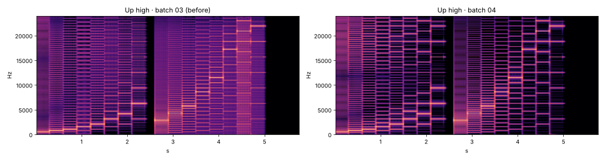
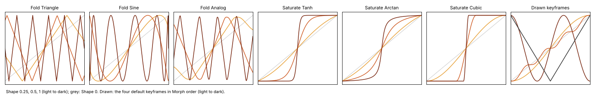
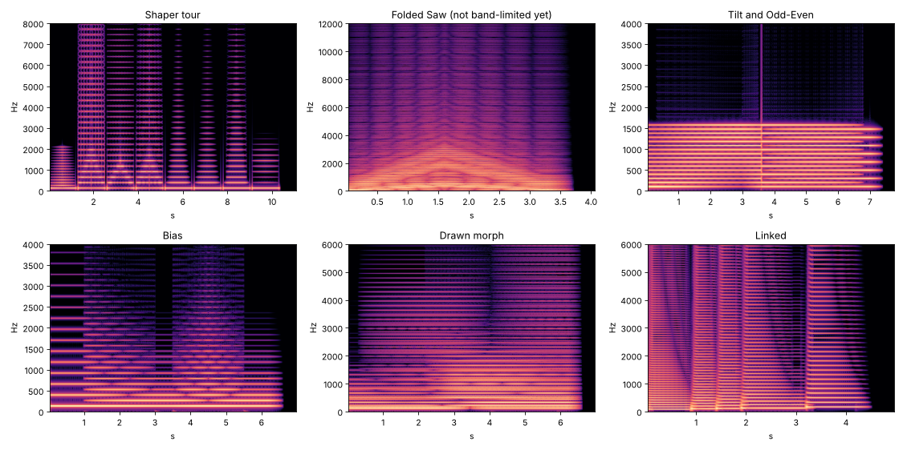
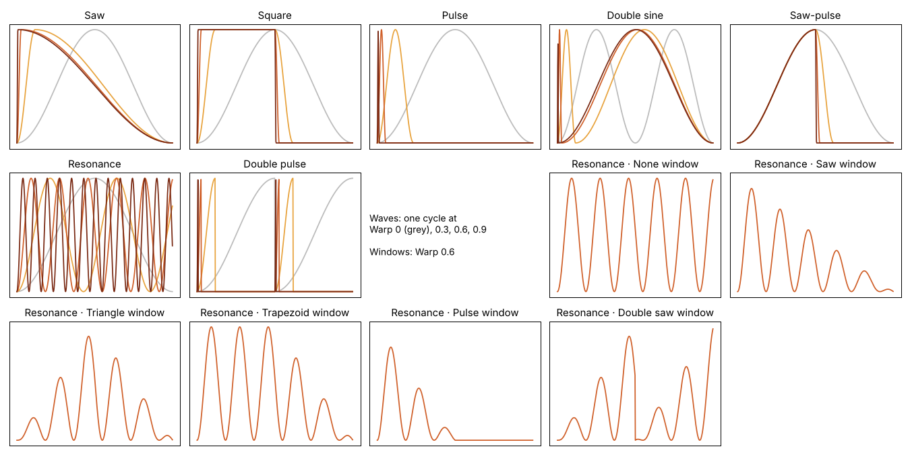
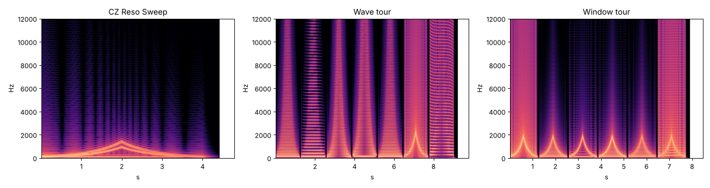

# Pretzel · tests

Quick results per batch: tests, experiments and pictures. Pictures live in `docs/tests/`. Run the
tests with `node tests/engine-test.js`. Presets are the test presets in `reference/presets.js`;
the ones marked `design` are those of `design.md` §11.

**Now: 87 engine tests passing** (about 12 s). Renders: `node tools/render-presets.js`. Aliasing table: `node tools/alias.js` (about 1 minute).

## Batch 04 · band limiting

`tools/alias.js` renders a steady note and measures the energy that is not a harmonic of it, from
20 Hz to 20 kHz, against the harmonics. The matrix: 10 waves (Resonance alone and with each CZ
window) × 7 shaper settings (none, Chebyshev 1/k at Shape 1, Sine fold ½, Triangle fold 1, Analog
fold ½, Tanh 0.7, Drawn ½) × Warp ½ and 1 × MIDI 24, 48, 72, 96, 108: 700 settings. Full tables:
`docs/tests/04-alias-before.txt` and `docs/tests/04-alias.txt`. The measuring floor is about −90 dB.

| | below −60 dB | below −50 dB | median | worst |
|---|---|---|---|---|
| Batch 03 | 303 of 700 | 343 | −48 dB | **+21 dB** (Triangle fold on Resonance, MIDI 108) |
| Batch 04 | 593 of 700 | 665 | −83 dB | **−38 dB** (Triangle fold on Double pulse, MIDI 108) |

Below −60 dB per note, batch 03 → 04: MIDI 24 130 → 140 of 140, 48 82 → 134, 72 59 → 125, 96 19 → 107,
108 13 → 87.

What it took, in the order it was found:

1. **The baseline** showed the plain CZ waves were already fine (−54 to −68 dB at MIDI 108): every
   breakpoint falls where the cosine is flat, so there is no jump or kink, only a change of
   curvature. Resonance without a window (hard sync, −19 dB) and Double pulse (jumps, −16 dB) were
   bad; every shaper made things 10–40 dB worse at high notes.
2. **polyBLEP and polyBLAMP on the wave, then ADAA on the shaper.** Plain Double pulse went from −16
   to −55 dB, but a jumpy wave into a shaper got worse: Double pulse into Drawn ½ went from −89 to
   −35 dB at MIDI 48. Smoothing a jump before the shaper sends the values between +1 and −1
   through the curve, and Drawn ½ sends both +1 and −1 to 0, so the smoothed jump became a spike.
3. **Split the sample at the breakpoint instead**, average each piece through the shaper, and put
   the jump's residuals on the *shaped* jump. Drawn on Double pulse came back to −90 dB. The
   residuals (box to triangle filter) gain 12–20 dB on jumps (Double pulse −41 → −53 dB at MIDI
   108); checked against direct integration to 2e−8.
4. **Split only where the wave really jumps or kinks.** Splitting at every breakpoint made the
   steep peak of a Pulse into Chebyshev alias at −32 dB instead of −66 (the straight line from
   each side up to the peak is a worse guess than one line across the sample).
5. **The Chebyshev fade** at 0.6–0.85 of the internal rate (where folding first reaches the audio
   band) left Chebyshev on a Saw at −49 dB at MIDI 96; at 0.3–0.45, as `design.md` first said, −60.
   It costs harmonics only where the wave is steepest: on a fully warped low note harmonics above
   about 3 fade.
6. **The chain-aware pitch cap.** A square-like wave into the Triangle fold at gain 10 was at
   +11 dB: the steep edge goes through ten folds in a few samples. The cap and the resonance ratio
   are now divided by how much the shaper steepens the wave: −50 dB. The resonance formant
   limit (0.12 of the internal rate after steepening) took the Sine fold on Resonance from −12 to
   −55 dB at MIDI 96.
7. **A crackle found by comparing renders.** The Shaper tour got a burst of noise at −58 dB above
   10 kHz where its Shape envelope closed to 0 on Tanh: log cosh written as |u| + log1p(e^−2|u|) −
   ln 2 loses all precision for tiny u, and ADAA divides that error by a tiny step. Now
   log1p(2·sinh²(u/2)) for small u. A test checks every family at tiny Shapes. After the fix, no
   render has more energy above 10 kHz than in batch 03 anywhere (largest +1 dB).

Also tested: every shaper's antiderivative has the shaper as its slope (5.7e−8); the Analog
folder, now a table, matches the Lambert W form to 1.5e−6 (and is much faster).

**Still above −60 dB:** the Triangle fold at full gain on high notes (−38 to −50 dB; its own
sharp creases need more than first-order ADAA), Chebyshev on Double pulse (−39 dB) and on a
windowed Resonance at full Warp (−40 to −48 dB at MIDI 72–108). Second-order ADAA or 8× for the
Triangle fold is the next step if it is heard.

Cost: renders take 3–16% of real time on one core (up to 1.5× batch 03).

Renders: all presets again (they change only by the band limiting, which is inaudible except at
high notes: energy above 10 kHz within 1 dB of batch 03), plus **Up high**, a run to MIDI 103
through the Sine fold and then hard-synced Resonance, also rendered with the batch 03 engine for
comparison.

## Batch 03 · shaper

The four shaper families after the warp: Chebyshev (16 harmonics, Tilt, Odd/Even), Fold (Triangle,
Sine, Analog), Saturate (Tanh, Arctan, Cubic) and Drawn (four keyframes, Morph, stored
antiderivatives). Bias, the Shape envelope, Link, key follow and velocity. No antialiasing on the
shaper yet: batch 04.

- **Shape 0 is exact** in all 8 shapers (difference 0), and a tiny Shape moves none of them by
  more than 0.1%. The Analog folder bends the wave slightly even at gain 1 (its peak came out at
  0.94); that bend is added back, so it is exact too.
- **Chebyshev is exact.** A full-scale cosine at Shape 1 gives each harmonic at its slider's share
  (error 4e−16), nothing above 16, no DC. After a warp, harmonic 3 alone is the cosine read at 3 ×
  the warped phase, to the cosine table's precision (3e−6): the identity behind batch 04's exact
  band limit holds in the engine.
- **The weights are scaled to add up to 1.** First render: Tilt and Odd-Even (all 16 harmonics at
  full, Tilt +1) clipped hard, because the sum reached 136. Scaled, the output can never pass ±1
  and the harmonics keep the sliders' ratios.
- **How Shape brings the harmonics in** took three tries, judged by the energy-weighted harmonic
  number at Shape 0, ¼, ½, ¾, 1 (all 16 sliders up):
  - Shape^((k−1)/2), fundamental crossfaded: 1.00 → 1.00 → 1.03 → 1.44 → 8.50. Almost nothing
    until the top of the knob.
  - Shape^((k−1)/4): earlier, but a Shape of 0.0001 already moved the wave by 6% (the curve is
    vertical at 0).
  - Shape^(1 + (k−2)/4), fundamental in a straight line from 1 to its slider: 1.00 → 1.00 → 1.04
    → 1.78 → 8.50, harmonic 2 comes in linearly, and at Shape ½ harmonics 2, 8, 16 sit at −30, −39,
    −51 dB. Kept. Still weighted toward the top of the knob when every slider is up: worth a listen
    in the Shaper tour and Tilt presets.
- **Fold gain** was 1 + 9·Shape; at Shape ¼ the triangle already folded three times. Now
  10^Shape (1.8 at ¼, 3.2 at ½). More folds at every step for all three folders (zero crossings
  per cycle 2 → 6 → 10 → 18 at Shape 0, 0.4, 0.7, 1).
- **Saturate**: odd harmonics only at Bias 0 for all three curves; Bias 0.5 brings harmonic 2 to
  −6 to −8 dB. Everything stays within ±1.
- **Lambert W** (for the Analog folder) solves w·e^w = e^L from L = −40 to 300 to 1e−7. The first
  version gave NaN for small arguments; small values now use a series and Newton's method in plain
  form.
- **Drawn**: morphing the antiderivatives gives the antiderivative of the morph (1e−15), and the
  stored antiderivative's slope is the curve between table points too (3e−8). Ready for ADAA.
- **Envelopes and Link.** The Shape envelope opens the fold and settles; Link 1 lets the Warp
  envelope fold the wave; soft notes and high notes (with key follow) fold less.
- **Levels** through every shaper at Shape ½ and 1, Warp 0 and 0.6: −1.6 to +0.9 dB from the plain
  wave. No test preset clips (loudest peak 0.63).

Folded Saw shows the aliasing still to come off (the curved lines that fall as the fold rises):
batch 04.

Renders: the design presets Organ Pretzel, Linked and Folded Saw, plus Shaper tour, Drawn morph,
Bias, and Tilt and Odd-Even. Presets 01–07 sound as before (Shape 0 changes nothing).

## Batch 02 · one line, CZ warp

One line per voice: the CZ waves and windows, window on any wave, wave pairs, Warp with its own
curve and the pitch cap, 8-stage Warp and Amp envelopes, Poly 8 and Mono with glide. Runs at 4×
with the 128-tap decimator (brought forward from batch 04, since nothing sounds without it). No
antialiasing yet beyond that.

- **The chip.** Each wave and window was checked against a direct transcription of MAME's
  `upd933.cpp` integer code at every one of its 2048 positions and five Warp settings. The worst
  difference is 0.0015 of full scale, which is the chip's own 11-bit rounding.
- **Warp 0 is a pure cosine** for Saw, Square, Pulse, Saw-pulse and Resonance (other harmonics
  below −200 dB). Two exceptions, both as on the chip: Double sine is a pure cosine an octave up,
  and Double pulse is never pure (each half resets).
- **Warp curve.** The pivot halves every 1/7 of the knob, so brightness grows at every step
  (energy-weighted harmonic number 1.00 → 1.23 → 1.64 → 2.01 → 2.10 for Saw at 0, ¼, ½, ¾, 1).
  The top quarter adds little, because the pivot is already very short there. Worth a listen: a
  gentler curve (6 octaves instead of 7) may spread it better.
- **Pitch** within 0.001 cent on Saw, Square and Resonance; Transpose and bend add up.
- **Wave pair** Saw + Pulse sounds exactly an octave lower; a wave paired with itself changes
  nothing.
- **No DC, no thump.** Windowed waves have a large DC offset (the window keeps the unipolar
  carrier above zero). The line's DC blocker starts at the wave's mean, so notes start clean: without
  that, Resonance + Triangle window started with an offset of 11% of its peak, Pulse + Pulse window
  17%. Now under 1%.
- **Levels** (after your first listen: about 8 dB between presets). Two causes, both fixed:
  - *The amp envelope's 72 dB scale.* Every sustain below 1 dropped fast (0.7 was −22 dB). Amp gain
    is now the level squared: 0.5 is −12 dB.
  - *The wave's own shape.* A narrow Pulse is 16 dB below a Saw, Square 3 dB above, and the
    windows take 3–11 dB off Resonance. Each line now measures its wave's RMS every block and
    evens it out to the power 0.7, as in Throat. Every wave, Warp and window now sits within
    −3.3 to +0.9 dB of the Saw. Pulse and Double pulse at high Warp are spikes: matching their RMS
    pushed peaks to clipping (tried peak limits of 2.5, 4 and 8 times a cosine's peak; 8 clipped
    the Wave tour). At 4 they stay at most 12 dB down.
  - Measuring needed care: 64 even points per cycle missed a narrow pulse completely and boosted
    it by the full +12 dB. The cycle is now cut at the warp's breakpoints, with 16 points per piece.
  - Renders now: single-note presets −19.7 to −21.7 dB RMS. CZ Brass plays four-note chords, so
    its Volume is 6 dB down to match.
- **Same output at any buffer size** (128, 37 and 1 samples): bit for bit.
- **Envelopes.** Sustain holds (0.02 dB drift), level 0.5 sits 12.0 dB below level 1, a release
  jumps past the sustain point and the voice stops, an envelope with no sustain point runs to its
  end with the key held.
- **Voices.** Poly holds 8. Mono glide changed from an exponential (which never quite arrived:
  7 cents short after 4.5 time constants) to a straight line in pitch that arrives in the Glide
  time, whatever the interval.
- **High notes.** MIDI 108 at full Warp on every wave stays finite and below clipping. It aliases:
  batch 04.

Renders (48 kHz, 24-bit): the two design presets CZ Brass and CZ Reso Sweep, plus five that show
the warp on its own (Wave tour, Window tour, Windowed saw, Wave pair, Square lead in Mono). Each
renders at 2–8% of real time on one core.
